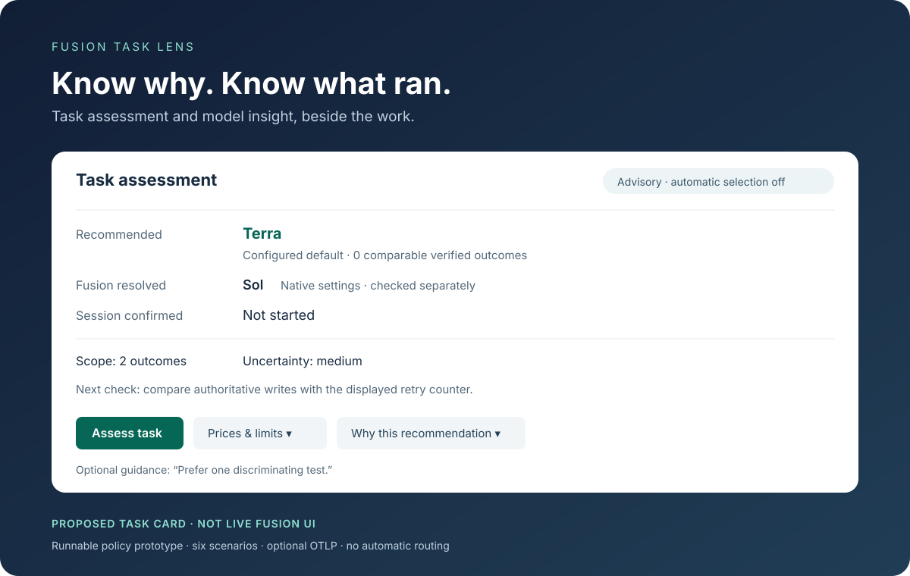
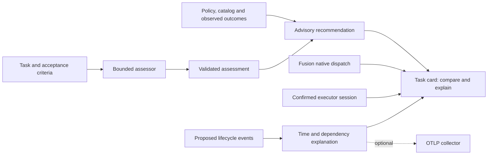

<p align="center"></p>

# Fusion Task Lens

**Understand the task. See the recommendation. Know what actually ran.**

Fusion gives agents a place to work. Task Lens explores how to make that work easier to understand: whether a task needs splitting, which model might fit, why work is waiting, and where time is being lost.

**Community prototype · automatic selection unavailable/off · no production rollout**

This repository contains runnable policy helpers, six synthetic scenarios, an optional OTLP exporter, and a proposed Fusion user experience. It is an independent project, not an official Fusion feature. The image above is a concept illustration, not a screenshot of installed functionality.

## Why this belongs beside a Fusion task

A busy activity feed can tell you that things happened. The next useful question is **what should I do now?**

| What the user sees | What Task Lens is designed to explain | Useful next step |
| --- | --- | --- |
| A task keeps growing | Too many independently verifiable outcomes | Review a proposed split |
| A different model is recommended | Capability requirements, evidence coverage, limits and policy | Compare the recommendation with Fusion's resolved model |
| CI is taking a long time | Queue delay versus job execution | Investigate runner slots or the job itself |
| Work is blocked | A missing prerequisite or compatible worker | Resolve the specific dependency |
| The agent repeats itself | Equivalent outcomes across attempts without new acceptance evidence | Choose one discriminating check |
| Activity suddenly stops | Last confirmed heartbeat and an unknown interval | Check worker status before deciding whether to resume |

These are product goals illustrated by synthetic scenarios. There is no measured productivity or cost improvement yet.

## Try the prototype

Requires Node.js 22.12 or newer. No API key, Fusion service, npm dependencies, or model call is needed.

```sh
git clone https://github.com/sekistner/fusion-task-lens.git
cd fusion-task-lens
npm test
npm run demo
```

The demo prints six scenario reports. `oversized` proposes decomposition; `slowCi` separates 30 minutes of queue time from 7 minutes of execution; `slowBuild` shows 2 minutes of queue time and 35 minutes of execution. `capacity`, `retry`, and `workerLost` cover missing capacity, repeated outcomes, and lost liveness.

## A small selector, with the details one click away

The proposed task card has just five essentials:

- **Assess task** — an explicit action with a separate assessment model and budget.
- **Recommendation + reason** — including “configured default; no comparable outcomes yet.”
- **Fusion resolved / session confirmed** — separate facts, with “not started” when appropriate.
- **Optional guidance** — a short free-text note, treated as task data.
- **Prices & limits** — expandable context/output limits, billing, quota state, and price freshness.

Advanced defaults live in project settings. Assessment never starts execution or changes Fusion's native model settings. Advice to split or investigate remains advice; it does not create a workflow hold. [Read the process and UI design →](docs/user-experience.md)

## What works today

| Capability | Status |
| --- | --- |
| Validated task assessment request/response helpers | Implemented; caller must supply an enforcing model adapter |
| Advisory model eligibility and recommendation policy | Implemented and tested with fixtures |
| Scope, waiting, retry and heartbeat scenarios | Six runnable synthetic examples |
| OTLP/HTTP JSON traces containing bounded timing/enumeration fields | Local mock receiver tested; no live Fusion event subscription |
| Fusion plugin `/scenarios` route | Loaded in one disposable Fusion 0.77.0 project |
| Real model assessment | One separate local Codex CLI trial; receipt included |
| Native Fusion model resolution comparison | Checked in that paused local trial; executor not launched |
| Task card, live lifecycle data, task persistence adapter, catalog refresh | Proposed; not implemented |
| Automatic model selection | Not implemented; remains off |

The package remains `private: true` to prevent accidental npm publication. Public GitHub source does not imply a supported plugin release. Do not add it to a production runtime based on this exercise.

## The first real assessment

A synthetic retry-counter diagnosis task was assessed by `openai-codex/gpt-6.1-terra` through a separate local CLI harness. The assessor identified two outcomes, medium uncertainty, and the need for a test that distinguishes write ordering from a stale display.

| Observation | Recorded result |
| --- | --- |
| Assessor elapsed time | 10.337 seconds |
| Input / output tokens | 12,138 / 106 |
| Recommendation | Terra, configured policy baseline, 0 comparable outcomes |
| Fusion native resolver | Sol, from deliberately configured native settings |
| Confirmed executor session | None — task paused, no executor launched |
| Automatic selection | Off |

The difference between recommendation and resolved model is intentional and useful: it demonstrates that observation did not take over dispatch. It does **not** demonstrate that Terra is better than Sol or that a Sol session authenticated successfully.

The 12,000-character setting limits task-data characters, not total provider input tokens. The CLI adds input of its own. Catalog limits and prices in the receipt are historical local configuration, not current provider guarantees; subscription billing is not “free.” [Trial details and limits →](docs/local-trial.md)

## Design foundations

The concept draws on [MetaCogAgent](https://arxiv.org/abs/2605.17292), which combines task-capability assessment, delegation, and feedback. Task Lens adapts that pattern to a Fusion operator workflow. It is not a reproduction of the paper or its benchmark results. A model's self-reported confidence is not treated as an observed success rate.



[Architecture and lifecycle →](docs/architecture.md) · [Astra review →](docs/astra-review.md) · [Roadmap →](docs/roadmap.md)

## Help shape it

The next useful feedback is from Fusion users: where would the card help you make a decision, which waits are hardest to explain, and what would make a recommendation trustworthy? Open an issue with a synthetic example. Keep task content, credentials, private infrastructure details, and account data out of public reports.

MIT licensed. Fusion and model names belong to their respective owners; no affiliation or endorsement is implied.
