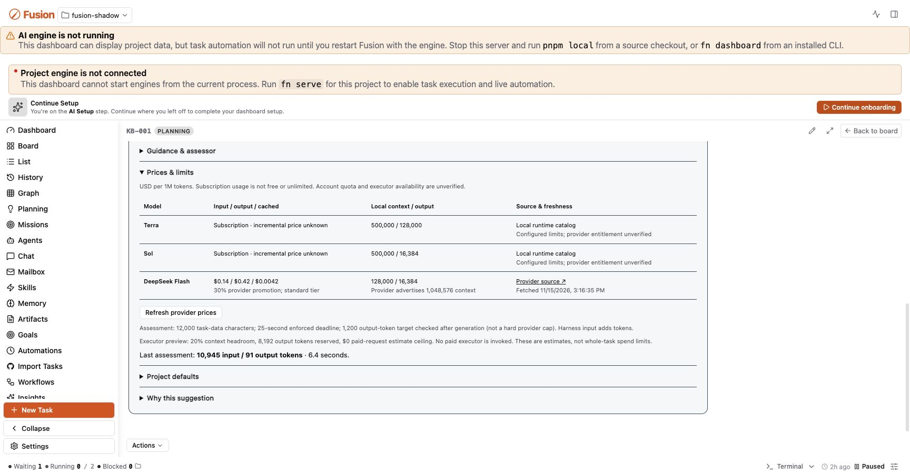

# Fusion Task Lens

**Understand the task. See the suggestion. Know what Fusion resolved.**

A small assessment card inside Fusion's **Definition** tab. Ask a real assessor to examine the saved task, see its scope, uncertainty and pitfalls, inspect token prices and limits, and compare the configured model suggestion with Fusion's native executor resolution.

**Manual assessment · automatic selection unavailable/off · Fusion 0.77.0 only**


*Actual disposable Fusion UI with a real assessor result. The engine-disabled banner is intentional: assessment is explicit, and native task execution is disabled.*

## What improves the Fusion workflow

- **A useful check before work starts.** The assessor identifies independently verifiable outcomes, uncertainty, an acceptance check and anticipated pitfalls. Large or uncertain tasks can prompt a split or discovery suggestion.
- **Model facts kept separate.** The card shows a policy suggestion, native executor resolution, and whether a session has been checked. A recommendation is never silently applied.
- **Prices with context.** Expand local context/output limits, public provider prices with timestamps, subscription uncertainty and measured assessor token usage.
- **Small controls, accessible defaults.** An optional note and per-call assessor choice sit behind a disclosure. Project defaults persist in Fusion's plugin settings; advanced limits stay folded away.
- **Honest operational insight.** Six synthetic lifecycle scenarios distinguish CI queue delays, slow jobs, missing capacity, repeated outcomes and lost liveness. Live lifecycle collection is still future work.

There is no measured productivity, quality or cost improvement claim. The current model suggestion follows configured preferences and estimated limits; capability fit, executor authentication, quota and availability remain unverified. No historical outcome calibration is used by the live card.

## Try the code without model calls

Node.js 22.12 or newer; no dependencies or credentials required for these commands:

```sh
git clone https://github.com/sekistner/fusion-task-lens.git
cd fusion-task-lens
npm test
npm run demo
```

The tests cover policy, local routes, settings, cancellation, stale input and OTLP transport. The demo prints six synthetic scenario reports.

## Try the real Fusion card

For an existing running instance, the [native adapter](live/README.md) uses Fusion’s signed-in AI session without requiring the task engine to pause. Its inline card still requires a reviewed dashboard image update.


Follow the [disposable setup instructions](local/README.md). You need the pinned Fusion package, a private local PostgreSQL database and an already signed-in Codex CLI. A version-checked local dashboard patch mounts the card; this is not a generic drop-in dashboard plugin or a production release.

1. Open a task's **Definition** tab.
2. Review **Project defaults**, or leave the defaults alone.
3. Click **Assess task**. One real CLI call assesses saved text; unsaved editor text is excluded.
4. Expand **Prices & limits** or **Why this suggestion**.
5. Edit the task or change defaults: the old assessment becomes stale. Reassessment is explicit.

The package stays `private: true` to prevent accidental npm publication. No engine dispatch hook or automatic-selection switch exists.

## Settings that actually work


Default assessor, project guidance, task-data size, deadline and output target flow into the real assessor request. Baseline, fallback order, scope threshold, context headroom, output reserve and paid-request estimate ceiling control advisory calculations. The two historical calibration settings are explicitly **scenario-only** until verified outcomes exist.

Save validates settings. Discard restores saved values. A detected external change offers **Reload saved defaults**. Editing settings does not change Fusion's native executor configuration. Conflict detection is optimistic; it is not a database transaction shared with Fusion's native settings editor.

## Prices, limits and measured usage



Public DeepInfra prices are fetched separately from task data. Local configured limits and provider-advertised context are distinct. Subscription cost/quota is unknown rather than zero. Discounts have freshness and expiry handling.

The CLI enforces the configured wall-clock deadline. Its output-token target is checked **after generation**, because this adapter has no supported hard provider-side generation cap. A failed call may still consume tokens; known failure usage is retained. Task-data character limits do not cap total harness input tokens.

## What is implemented

| Capability | Status |
| --- | --- |
| Task card inside native Definition | Working in the disposable, pinned Fusion installation |
| Real structured assessor | Local signed-in Codex CLI, explicit call, cancellation and deadline |
| Saved project defaults | Native plugin settings, validation, stale-result detection and conflict UI |
| Task/setting change during inference | Result discarded; existing task/executor settings untouched |
| Assessment persistence | Private sidecar files scoped by project, task and fingerprints |
| Native model comparison | Read-only executor resolver; assigned-agent routes shown as unchecked |
| Price/limit drawer | Public DeepInfra refresh, example local limits, actual assessor usage |
| Lifecycle/OTLP helpers | Synthetic scenarios and local transport tests; no live event stream |
| Session confirmation / automatic routing | Not implemented; card never launches an executor |

## Review and evidence

GPT-6 Astra reviewed the concept, implementation and settings. The review led to settings wiring, clearer preference-only advice, cancellation fixes, request ordering, retained failed usage and portable installation files. See the [review and verification record](docs/astra-review.md).

The [initial local trial](docs/local-trial.md) deliberately compared a Terra suggestion with a Sol native resolution while paused. Subsequent UI trials exercised the actual card. Screenshots show the local experiment, not a production deployment. See [UI acceptance evidence](docs/ui-verification.md).

## Design foundations and next steps

The concept draws on [MetaCogAgent](https://arxiv.org/abs/2605.17292): task-capability assessment, delegation and feedback. This project adapts that idea to a Fusion user workflow; it does not reproduce the paper's benchmark results or claim calibrated model intelligence.

[Process and UI design](docs/user-experience.md) · [Architecture](docs/architecture.md) · [Roadmap](docs/roadmap.md) · [Contributing](CONTRIBUTING.md)

Independent community project, MIT licensed. Fusion and model names belong to their owners; no affiliation or endorsement is implied. Feedback from Fusion users is welcome through synthetic examples without private task content or credentials.
