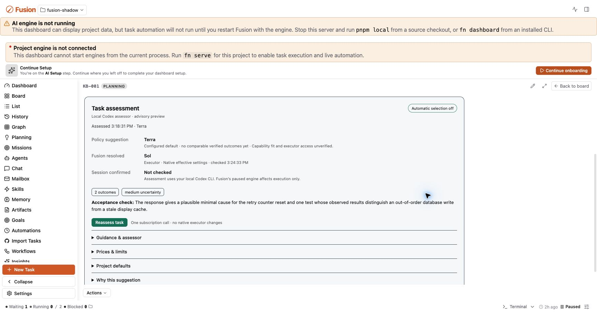
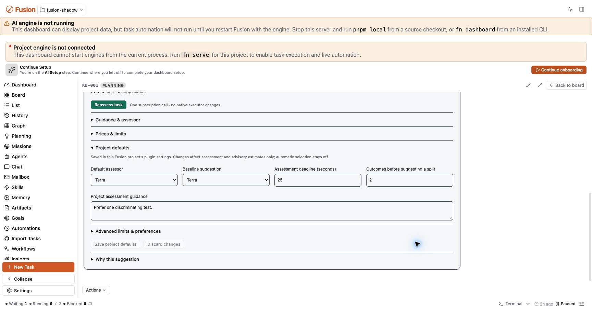
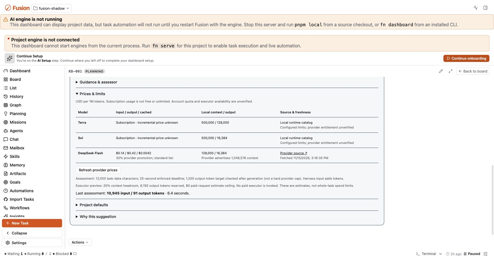

# Working UI verification — 2026-11-15

This is a local integration exercise in a disposable Fusion 0.77.0 project with a synthetic task. The dashboard runs without an execution engine and is paused. It is not a production rollout or a usability study.

## Real assessment from the card

Clicking **Assess task** invoked Terra through the signed-in local Codex CLI. The saved 25-second project deadline and project guidance were used. The result recorded **10,945 input tokens, 91 output tokens, and 6.368 seconds**. It assessed two outcomes with medium uncertainty and returned an acceptance check and pitfalls. The [sanitized receipt](../examples/ui-trial.json) contains the actual result and settings.

The card's configured-policy suggestion was **Terra**. Fusion's native executor resolver returned **Sol**. No executor session was started, so Session confirmed remains **Not checked**. These are three different facts. Automatic selection is unavailable and off.

## Settings checks

- Edited a project default: assessment became disabled until Save or Discard.
- Discard restored the saved value and enabled assessment.
- A zero-second deadline was rejected; the persisted deadline stayed valid.
- An external native-settings change while the card had unsaved edits showed a conflict, disabled Save, and offered Reload saved defaults. Reload restored the external value.
- Saved a 25-second deadline through the card and confirmed it in native plugin settings and the real assessment receipt.
- Reloaded the dashboard and confirmed the assessment and settings persisted. The final layout places saved task text before the card.
- Inspected advanced task-data/output targets, headroom, output reserve, paid-request estimate ceiling and fallback preferences. Historical calibration controls are separated as scenario-only.

These conflict checks prevent observed stale card writes, but the native plugin store does not offer a cross-writer atomic compare-and-swap transaction.

## Prices, limits and usage

The price drawer fetches the public DeepInfra catalog and labels the source, fetch time and promotion. Subscription incremental prices and account quotas are **unknown**, not zero. Local context/output settings are distinguished from provider-advertised context. The screenshot is a dated observation, not a price promise.

The drawer shows actual assessor usage, the enforced deadline and the post-generation output target. Neither the paid-request estimate ceiling nor the output target is a whole-task or assessor spend cap.

## Regression evidence and limits

The standalone suite covers project/task/settings binding, immutable native task/model settings, invalid origins and automatic-selection requests, stale task/settings completion, duplicate calls, cancellation after unpausing, settings propagation, failure usage receipts, price-unit conversion and promotion expiry, plus the synthetic lifecycle and policy cases. See CI for the published revision's result.

Astra's implementation and visual review is recorded in [the review log](astra-review.md). Browser checks are manual agent-operated checks, not an automated browser suite. This exercise does not establish model quality, cost savings, confirmed executor access, live lifecycle telemetry or production readiness.

## Current Assessment tab

The new dedicated tab supersedes the inline Definition card. See [the real discovery/reassessment UI verification](assessment-loop-verification.md) for actual positive and unavailable evidence paths, native navigation and saved/discarded settings checks. Earlier screenshots and receipts above remain historical.
